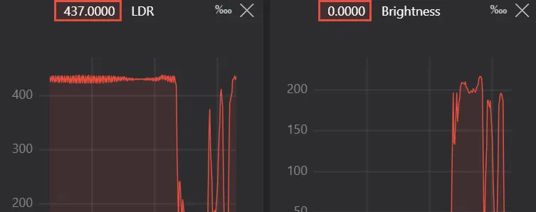

# Ambiance-LDR-Light

An Arduino night light that senses how dark the room is and fades an LED up smoothly as it gets darker. Built step by step as a learning project, with the code and notes committed along the way.

## What it does

- Reads room brightness with a light-dependent resistor (LDR).
- Converts the reading into a PWM brightness level.
- Fades the LED from off (bright room) to full (dark room).
- Streams the live LDR and brightness values to a graph.

<!--  -->

## Hardware

| Part | Qty | Role |
|---|---|---|
| Arduino UNO R4 WiFi | 1 | Controller (5 V logic) |
| LDR | 1 | Light sensor |
| 10 kΩ resistor | 1 | LDR voltage divider |
| 470 Ω resistor | 1 | LED current limiting |
| 5 mm LED | 1 | Output |
| Breadboard + jumper wires | 1 set | Wiring |

## Wiring

**LDR divider:** 5V → LDR → junction → 10
